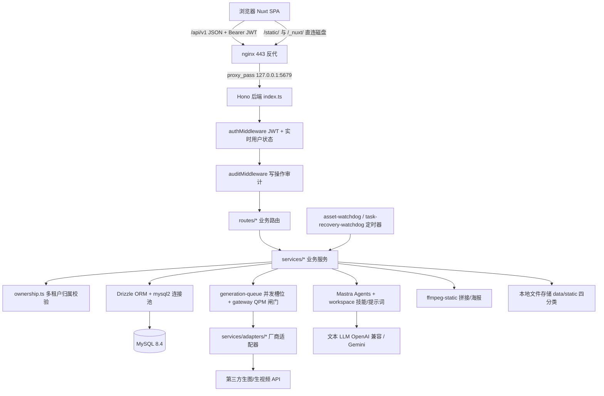

# Drama Mill 仓库上下文 Wiki（只读安全审查用）

> 生成方式：全程只读通读源码与配置（未执行任何安装/迁移/启动/写接口）。
> 密钥处理约定：本文不记录任何真实密钥明文；凭证类文件仅记录位置与类型，值一律打码（`***`）。
> 版本号以 `package.json` 声明 + `package-lock.json` 实际锁定版本为准。

---

## 1. 项目用途与整体架构

**Drama Mill（短剧工坊）** 是一个 AI 短剧自动化生产平台：上传小说/剧本原文 → AI 拆分剧集 →
剧本改写 → 资产提取（角色/场景/道具）→ 分镜拆解 → 图片/视频提示词生成 → 调用第三方
生图/生视频 API → ffmpeg 拼接成片。全 TypeScript 栈，AGPL-3.0 许可，多租户（按 `user_id` 归属隔离）。

### 1.1 模块划分

| 模块 | 位置 | 职责 |
|---|---|---|
| HTTP 入口 | `backend/src/index.ts` | Hono 应用组装：CORS → 请求日志 → onError；`/api/v1` 子应用叠 auth + audit；`/static/*` 素材分发（支持 Range/206）；前端 SPA 产物兜底；启动时拉起任务恢复与看门狗 |
| 路由层 | `backend/src/routes/`（29 个顶层文件 + `admin/` 19 个文件） | 业务 REST API，全部挂在 `/api/v1` 下 |
| 中间件 | `backend/src/middleware/` | `auth.ts`（JWT 鉴权 + adminGuard）、`audit.ts`（写操作审计落库、敏感字段脱敏）、`logger.ts`（请求日志、凭证字段掩码、错误兜底） |
| 服务层 | `backend/src/services/`（55 文件 + `adapters/` 13 文件） | 认证、归属校验、生成队列/网关限流、云端任务轮询、批量生产编排、看门狗、存储配额、成本计价、小说拆分等 |
| AI Agent | `backend/src/agents/` + `backend/src/mastra/` | Mastra Agent 装配（script_rewriter / extractor / storyboard_breaker / prompt_generator / novel_splitter），工具集在 `agents/tools/`，提示词与技能从 `backend/workspace/` 磁盘加载 |
| DB 层 | `backend/src/db/` | mysql2 连接池 + Drizzle ORM；模块加载即自动建表→迁移→种子（`initDb`，带重试） |
| 工具 | `backend/src/utils/` | 存储路径/写入/图片处理（sharp）、ffmpeg、速率配置、响应封装、任务日志、内容审核 |
| 前端 | `frontend/app/` | Nuxt 3 + Vue 3 SPA（`nuxt generate` 静态产物），纯 CSS 无组件库；页面/组件/composables/api 分层 |
| 运维 | `deployment/`、`nginx/`、`docker/`、根级编排文件 | PM2/systemd 部署、nginx 反代、Docker 一体化编排、磁盘监测、开机自愈、租户归属修复脚本 |

### 1.2 调用关系与前后端交互



- **前端 → 后端**：`frontend/app/api/core.ts` 统一 `fetch('/api/v1' + path)`，从
  `localStorage['drama_mill_token']` 取 JWT 注入 `Authorization: Bearer`；401 时清 token 跳 `/login`。
  API 门面 `composables/useApi.ts` 汇总 `api/{core,drama,assets,tasks,novel,production,config,admin,auth}.ts`。
- **开发期**：Nuxt dev server（3013）经 Vite proxy 转发 `/api`、`/static` 到 5679；后端 CORS 白名单
  `http://localhost:3013` 与 `http://localhost:5679`（credentials: true）。
- **生产期**：`nuxt generate` 产物复制到 `frontend/dist/`，由后端 `serveStatic` 提供（`/` → index.html，
  其余 → 200.html SPA fallback）；云端 nginx 再把 `/_nuxt/`、`/static/` 直连磁盘绕过 Node。
- **异步任务模型**：生成任务状态全部落库（`sys_task`），内存队列/轮询线程随进程重启丢失后由
  `resumeInterruptedTasks()` / `resumeRunningBatches()` 启动恢复；两个 setInterval 看门狗周期巡检。
  `DISABLE_TASK_RESUME=true` 可整体关闭恢复与看门狗。

---

## 2. 技术栈与框架版本

### 2.1 后端（backend/package.json，lock 实测版本）

| 类别 | 依赖 | 声明版本 | lock 锁定 |
|---|---|---|---|
| 语言/运行时 | TypeScript（tsx 直跑，无编译产物运行） | ^6.0.2 | Node 20（Docker）/ 22+（脚本部署） |
| Web 框架 | hono | ^4.12.9 | 4.12.9 |
| Node 适配 | @hono/node-server | ^1.19.11 | — |
| ORM | drizzle-orm（mysql2 驱动，非 drizzle-kit 运行时迁移，自研 SQL 迁移） | ^0.45.1 | 0.45.1 |
| DB 驱动 | mysql2（promise 连接池） | ^3.22.5 | 3.22.5 |
| Agent 框架 | @mastra/core | ^1.17.0 | 1.17.0 |
| AI SDK | @ai-sdk/openai ^3.0.48、@ai-sdk/google ^3.0.53 | — | — |
| 认证 | jsonwebtoken | ^9.0.3 | 9.0.3 |
| 密码哈希 | bcryptjs（cost=10） | ^3.0.3 | 3.0.3 |
| 校验 | zod | ^4.3.6 | — |
| 日志 | pino ^10.3.1（另有自研 console 请求日志 + task-logger） | — | — |
| 图像 | sharp | ^0.34.5 | 0.34.5 |
| 视频 | fluent-ffmpeg ^2.1.3 + ffmpeg-static ^5.3.0 + ffprobe-static ^3.1.0 | — | — |
| 文档解析 | mammoth（.docx 文本提取） | ^1.12.1 | — |
| 其他 | dotenv ^17.4.2、uuid ^13.0.0 | — | — |
| 开发 | tsx ^4.21.0、drizzle-kit ^0.31.10、node:test（tests/*.test.mjs） | — | — |

### 2.2 前端（frontend/package.json，lock 实测版本）

| 类别 | 依赖 | 声明版本 | lock 锁定 |
|---|---|---|---|
| 框架 | nuxt | ^3.17.5 | 3.21.2 |
| UI | vue | ^3.5.13 | 3.5.31 |
| 路由 | vue-router | ^4.5.1 | — |
| 图标 | lucide-vue-next | ^0.511.0 | — |
| 通知 | vue-sonner | ^1.2.4 | — |
| 样式 | 纯 CSS（app/assets/*.css），无 UI 组件库 | — | — |
| 开发 | typescript ^5.8.3、node:test | — | — |

### 2.3 基础设施

- **数据库**：MySQL 8.4（docker-compose 镜像 `mysql:8.4`；脚本部署要求 MySQL 8.0+），utf8mb4。
- **进程管理**：PM2 fork 单实例（`ecosystem.config.cjs`，应用内有内存任务状态，禁止 cluster）。
- **反代**：nginx 1.24 写法（TLSv1.2/1.3，Let's Encrypt，SSE 关缓冲，300s 超时，100MB 上传上限）。
- **容器**：三阶段 Dockerfile（node:20-slim；前端 generate → 后端原生依赖编译 → tsx 运行时），国内镜像源构建参数。
- **无 Redis/消息队列/对象存储**：队列与缓存均为进程内存实现（`ttl-cache.ts`、`generation-queue.ts`、`admin/count-cache.ts`），素材存本地磁盘。

---

## 3. 目录结构说明与关键入口

```
drama-mill/
├── backend/
│   ├── src/index.ts            ← 启动入口（tsx src/index.ts，端口 PORT||5679）
│   ├── src/routes/             ← 路由注册处：index.ts 内 api.route(...) 逐一挂载
│   │   └── admin/index.ts      ← /admin 子应用，整层 adminGuard
│   ├── src/middleware/         ← auth / audit / logger
│   ├── src/services/           ← 业务服务 + adapters/（厂商适配器注册表 registry.ts）
│   ├── src/db/index.ts         ← DB 入口：模块加载即 initDb（建表→迁移→种子，重试10次）
│   ├── src/agents/、src/mastra/← Agent 装配与 Mastra 中央实例
│   ├── src/utils/              ← storage-core/write/image、rate-config、ffmpeg 等
│   ├── scripts/                ← 13 个运维/迁移脚本（见 3.2）
│   ├── tests/                  ← 74 个 node:test 结构/单元测试（含 helpers/ 22）
│   ├── workspace/              ← Mastra Workspace jail 根：prompts/ + skills/（5 技能 9 文件）
│   ├── .env / .env.example     ← 运行时环境变量（见第 4 章）
│   └── .gen-smoke.mts          ← 生成模块冒烟检查脚本（import 后打印导出与队列状态）
├── frontend/
│   ├── nuxt.config.ts          ← srcDir=app/；pages:extend 手动注册动态路由；Vite proxy
│   ├── app/pages/              ← 文件路由：index/login/novels/settings/cloud-queue/novel-templates + admin/ 16 页
│   ├── app/views/drama/        ← 手动注册的动态路由视图（/drama/:id、/drama/:id/episode/:n）
│   ├── app/components/         ← 25 个组件（含 settings/ 8）
│   ├── app/composables/        ← 45 个（episode/ 26、detail/ 3、settings/ 6、顶层 10）
│   ├── app/api/                ← 9 个按域拆分的 API 模块，core.ts 为请求底层
│   ├── app/plugins/auth.client.ts ← 客户端 hydrate 后从 localStorage 恢复 token
│   ├── app/layouts/            ← default / studio / admin
│   └── tests/                  ← 46 个测试（含 helpers/ 13）
├── deployment/                 ← 7 个运维 shell（见 3.2）
├── nginx/                      ← drama-mill.conf + drama-mill.common.conf
├── docker/                     ← init.sql（36KB 建表+种子）、model-catalog-data.sql（5MB 数据快照）
├── data/static/                ← 运行时素材（审查范围外）：images/videos/merged/uploads 按 {user_id}/{drama_id} 分目录
├── drama/                      ← 小说原文素材（审查范围外）
├── Dockerfile / docker-compose.yml / ecosystem.config.cjs / package.json（部署入口）
└── .env.example / .dbpass.tmp / .rescue-historical.sh / CLAUDE.md / README.md 等根级文件
```

### 3.1 启动与定时任务入口

| 入口 | 位置 | 说明 |
|---|---|---|
| HTTP 启动 | `backend/src/index.ts` 末尾 `serve({ fetch: app.fetch, port })` | PM2: `tsx src/index.ts`；Docker: 同命令 |
| 路由注册 | `index.ts` L88–114 | `/api/v1` 子应用先 `authMiddleware` 后 `auditMiddleware`；`dramas-assets` 必须先于 `dramas` 注册（具体路径抢通配） |
| 任务恢复 | `services/generation.ts#resumeInterruptedTasks`、`services/production-batch.ts#resumeRunningBatches` | 启动时捞回 processing 任务/running 批次 |
| 资产看门狗 | `services/asset-watchdog.ts#startAssetWatchdog` | setInterval，默认 20 分钟（`ASSET_WATCHDOG_INTERVAL_MS`），为缺图资产补提图片任务 |
| 失败恢复看门狗 | `services/task-recovery-watchdog.ts#startTaskRecoveryWatchdog` | setInterval，默认 5 分钟（`GEN_TASK_RECOVERY_INTERVAL_MS`）：视频超时判死 + 失败自动重提（次数/窗口/单轮上限可配） |
| 生成队列 | `services/generation-queue.ts`（并发槽位）+ `generation-gateway.ts`（按网关 QPM 自适应节奏、429 指数退避） | 内存实现，任务状态在 `sys_task` 表 |
| 云端轮询 | `services/cloud-tasks*.ts`、`generation-poll.ts` | 提交后轮询上游 task_id 取结果 |
| DB 初始化 | `db/index.ts` 顶层 `await initDb()` | 建表（mysql-schema*.ts）→ 增量迁移与种子（migrations*.ts）→ 数据种子 |
| 开机自愈 | `deployment/drama-mill-boot-check.sh`（crontab @reboot）+ `drama-mill-services.sh` | mysqld → nginx → pm2 依赖顺序拉起 |
| 磁盘监测 | `deployment/disk-monitor.sh`（cron 每 30 分钟） | 写 `data/disk_status.json`，nginx `/disk_status` 无鉴权直出 |

### 3.2 运维脚本清单

- `backend/scripts/`：`export-init-sql.ts`、`export-catalog-sql.ts`、`migrate-model-catalog.ts`、
  `migrate-storage-layout.ts`（+ `migrate-storage-layout/{state,scan,files}.ts`）、
  `audit-storage-orphans.ts`、`backfill-artwork.ts`、`dedupe-active-image-tasks.ts`、
  `regen-episode-shots.ts`、`regen-missing-assets.ts`、`file-lines.baseline.json`（行数基线）。
- `deployment/`：`deploy.sh`（本地/云端一键部署，lock 哈希跳过重复 npm ci）、
  `deploy-remote.sh`（rsync over ssh 发布，默认目标 `aliyun-drama:/opt/drama-mill`，排除 .env/数据/密钥文件）、
  `disk-monitor.sh`、`drama-mill-services.sh`、`drama-mill-boot-check.sh`、
  `fix-tenant-attribution.sh`（历史文件租户归位 + DB 路径订正）、`install-root-scripts.sh`（上传 /root/ 脚本 + 注册 @reboot）。
- 根级：`.rescue-historical.sh`（一次性历史任务补跑：source backend/.env → 用 JWT_SECRET 自签 admin token → curl 调 `/admin/videos/rescue-historical`）。

---

## 4. 配置体系

### 4.1 配置文件位置

| 文件 | 作用 |
|---|---|
| `backend/.env` | 运行时实际环境变量（dotenv 加载）。**含真实数据库口令，值打码 `***`**。当前仅配置 9 个键：PORT、MYSQL_HOST/PORT/USER/PASSWORD/DATABASE、GEN_MAX_CONCURRENT_IMAGE/VIDEO、GEN_SUBMIT_INTERVAL_MS。**未配置 JWT_SECRET**（见 4.3） |
| `backend/.env.example` | 后端环境变量模板（必选 DB + 可选存储/并发/看门狗参数，含注释说明） |
| `.env.example`（根） | 面向 Docker/整体部署的模板：DATABASE_URL、JWT_SECRET（默认占位值 `***`）、JWT_TTL、存储分类路径等 |
| `docker-compose.yml` | 应用 + MySQL 8.4 编排；environment 内**明文写死 DATABASE_URL、JWT_SECRET、MYSQL_ROOT_PASSWORD 等默认凭证（值打码 `***`）**；宿主端口 5679/3307；挂载 ./data 与 ./backend/workspace |
| `Dockerfile` | 三阶段构建；ENV NODE_ENV=production PORT=5679；构建参数 APT_MIRROR/NPM_REGISTRY/PIP_INDEX |
| `ecosystem.config.cjs` | PM2：fork 单实例、TZ=Asia/Shanghai、日志 logs/app-{out,error}.log、max_restarts=10 |
| `package.json`（根） | 部署入口 scripts：deploy/publish/build/start/stop/restart/logs |
| `backend/package.json`、`frontend/package.json` | 依赖与 dev/build/test 脚本 |
| `backend/tsconfig.json`、`frontend/tsconfig.json`、`frontend/.nuxtrc` | TS/Nuxt 编译配置 |
| `frontend/nuxt.config.ts` | srcDir、pages:extend 动态路由、Vite dev proxy（/api、/static → 5679） |
| `nginx/drama-mill.conf` + `drama-mill.common.conf` | 80→443 跳转、ACME、TLS、反代参数、静态直连、/disk_status |
| `docker/init.sql`、`docker/model-catalog-data.sql` | MySQL 首次初始化：01 建表+内置种子，02 模型目录价数据快照（幂等 upsert） |
| `.dbpass.tmp`（根） | **临时数据库口令文件（ASCII 文本，25 字节），值打码 `***`**；deploy-remote.sh 已将其排除同步 |
| `.gitignore`、`.dockerignore` | 忽略规则（审查时可用于判断哪些敏感文件预期不入库） |
| `backend/src/utils/rate-config.ts`、`services/runtime-config.ts` | 运行时可配参数集中读取（env → 默认值） |
| DB 内配置 | AI 网关配置（provider/baseUrl/apiKey，`ai_configs` 表）、模型目录与刊例价（`model_catalog_*`）、用户模型价、提示词（磁盘 workspace/prompts 覆盖代码默认）、技能（workspace/skills）、重试配置（`/admin/task-retry-config`）、看门狗开关（`/auth/watchdogs`） |

### 4.2 环境变量清单（backend/src 实际读取，含 rate-config 间接键）

- **服务/DB**：`PORT`、`NODE_ENV`、`DATABASE_URL`（优先）、`MYSQL_HOST/PORT/USER/PASSWORD/DATABASE`、`MYSQL_CONNECTION_LIMIT`（默认 30）、`MYSQL_QUEUE_LIMIT`（默认 200）
- **认证**：`JWT_SECRET`（**代码内有硬编码默认回退值，位置 services/auth.ts L27，值打码**）、`JWT_TTL`（默认 7d）
- **存储**：`STORAGE_PATH`、`ASSET_PATH`、`VIDEO_PATH`、`MERGED_PATH`、`UPLOAD_PATH`、`PUBLIC_BASE_URL`（本地素材换算公网地址给 Seedance 参考）、`STORAGE_QUOTA_GB`（默认 1GB/用户）
- **文本 AI**：`TEXT_AI_MAX_CONCURRENT`（默认 3）、`TEXT_AI_MIN_INTERVAL_MS`、`AI_DISABLE_THINKING`、`AI_THINKING_OFF_PATCH`、`AI_MAX_TOKENS`、`AI_CONFIG_TEST_MAX_MS`
- **生成调度**：`GEN_MAX_CONCURRENT`、`GEN_MAX_CONCURRENT_IMAGE/VIDEO`、`GEN_SUBMIT_INTERVAL_MS`（默认 2000）、`BATCH_DRAMA_CONCURRENCY`（默认 1）、`BATCH_STOP_ON_ERROR`、`BATCH_STAGGER_DELAY_MS`、`PROD_EPISODE_CONCURRENCY`（默认 3）、`PROD_PRE_STORYBOARD_CONCURRENCY`、`PROD_PRE_VIDEO_CONCURRENCY`
- **看门狗/恢复**：`DISABLE_TASK_RESUME`、`VIDEO_TASK_TIMEOUT_MS`（默认 30min）、`VIDEO_TASK_HARD_LIMIT_MS`、`GEN_TASK_RECOVERY_INTERVAL_MS`（默认 5min）、`GEN_TASK_AUTO_RETRY_MAX`（默认 3）、`GEN_TASK_AUTO_RETRY_WINDOW_MS`（默认 6h）、`GEN_TASK_AUTO_RETRY_MIN_AGE_MS`（默认 2min）、`GEN_TASK_AUTO_RETRY_MAX_PER_SWEEP`（默认 20）、`ASSET_WATCHDOG_INTERVAL_MS`（默认 20min）、`ASSET_WATCHDOG_MAX_RESUBMIT`、`UPSTREAM_WATERMARK_CHECK_INTERVAL_MS`、`UPSTREAM_WATERMARK_MAX_WAIT_MS`、`UPSTREAM_VIDEO_PENDING_WATERMARK`
- **其他**：`CATALOG_USD_CNY_RATE`、`GREEN_NET_FIX_MAX`、`TZ`（PM2）
- **部署脚本侧**：`REMOTE_HOST`、`REMOTE_DIR`、`PUBLIC_URL`（deploy-remote.sh）；`DISK_THRESHOLD`、`INODE_THRESHOLD`（disk-monitor.sh）

### 4.3 配置要点（事实记录，不下结论）

- `backend/.env` 当前未设置 `JWT_SECRET`；`services/auth.ts` 与 `.rescue-historical.sh` 均存在同一硬编码默认回退值；`docker-compose.yml` 与根 `.env.example` 也写有同一默认占位值。
- `docker-compose.yml` 的 environment 与 mysql healthcheck 中含明文默认数据库口令/root 口令。
- `db/index.ts` 在未配置时回退默认用户名/口令（`dramamill` / 默认口令，值见源码）；容器内默认连 `host.docker.internal`。
- `db/migrations-seed.ts` 内置种子账号：`drama-mill`（admin）与 `test`（user），默认口令为同一弱口令（值打码，见源码 L13–14）；护栏：库内已有任意 admin 则不再新建 admin 种子。
- CI：仓库内未见 CI 配置（无 .github/workflows 等）；发布走 `deployment/deploy-remote.sh`（ssh + rsync）。

---

## 5. 对外接口清单与鉴权方式

### 5.1 鉴权机制总述

- **JWT Bearer**：`middleware/auth.ts#authMiddleware` 挂在 `/api/v1` 子应用全局。
  `Authorization: Bearer <token>` → `jsonwebtoken.verify`（HS256，密钥 `JWT_SECRET` 或默认回退值，TTL 默认 7d）
  → **每请求实时查库**校验用户存在且 `status='active'` → 注入 `c.set('user')`（含实时 `aiCallEnabled` 开关）。
- **白名单（免鉴权）**：`/api/v1/health`、`/api/v1/auth/login`（AUTH_WHITELIST 精确匹配）。
- **完全不经 auth 中间件的对外路径**：`/static/*`（Node 端素材分发，注释说明因 img/video 标签无法带鉴权头；
  `resolveStaticFile` 拒绝 `..`/`.`/空段）、nginx 直连的 `/static/`、`/_nuxt/`、`/disk_status`、SPA 壳页。
- **管理员守卫**：`adminGuard`（role==='admin'）整层挂在 `/api/v1/admin/*`；另外 `/api/v1/skills/*` 路由自带整层 adminGuard。
- **多租户归属**：`services/ownership.ts` 提供 `getDramaOwned/getEpisodeOwned/getStoryboardOwned/getCharacterOwned/getSceneOwned/getPropOwned/getNovelOwned`，
  资源经 `drama.user_id` 间接归属，未归属一律 404（隐藏存在性）；novels 早期无 user_id 行回退按所属项目归属。
- **审计**：`auditMiddleware` 对 POST/PUT/DELETE 异步落 `audit_logs`（api_key/password/token/secret 字段脱敏，body 截断 2000 字符，IP 取 X-Forwarded-For 首段）。
- **其他闸门**：用户级 `aiCallEnabled` 总开关（`services/ai-switch.ts#assertAiCallEnabled`）、看门狗用户开关（`watchdog-switch.ts`）、存储配额（`storage-quota.ts`）。
- 前端 token 存 `localStorage['drama_mill_token']`；`plugins/auth.client.ts` hydrate 后恢复；401 统一跳登录。

### 5.2 逐路由文件端点分组（前缀均为 /api/v1；除注明外全部要求 JWT）

**业务路由（backend/src/routes/）**

| 路由文件 | 挂载前缀 | 主要端点分组 | 鉴权 |
|---|---|---|---|
| `auth.ts` | /auth | POST /login（**白名单免鉴权**）、POST /logout、POST /change-password、GET /me、GET/PUT /ai-call（模型调用总开关）、GET /storage-quota、GET/PUT /watchdogs | JWT（login 除外） |
| `dramas.ts` | /dramas | GET /（列表）、GET /stats、GET /:id、POST /、PUT /:id、DELETE /:id | JWT + ownership |
| `dramas-assets.ts` | /dramas（先注册） | GET /:id/assets-status、PUT /:id/characters、PUT /:id/episodes（资产批量保存） | JWT + ownership |
| `dramas-shared.ts` | —（helper） | countByDrama / normalizeMetadata，无端点 | — |
| `episodes.ts` | /episodes | POST /、GET /:id、PUT /:id、DELETE /:id、GET /:id/characters\|props\|scenes；内挂 episodes-pipeline | JWT + ownership |
| `episodes-pipeline.ts` | （episodes 子路由） | POST /:id/extract、/:id/retry-extraction、/:id/generate-video-prompts、/:id/retry-video-prompts；GET /:id/extract-status、/:id/pipeline-status、/:id/generation-tasks、/:id/video-prompts-status、/:id/timings、/:episode_id/storyboards | JWT + ownership |
| `storyboards.ts` | /storyboards | POST /、PUT /:id、DELETE /:id | JWT + ownership |
| `characters.ts` | /characters | CRUD + POST /:id/generate-image、/:id/generate-prompt、/batch-generate-images | JWT + ownership |
| `scenes.ts` | /scenes | 同 characters 结构 | JWT + ownership |
| `props.ts` | /props | 同 characters 结构 | JWT + ownership |
| `tasks.ts` | /tasks | POST /（提交生成）、GET /（列表）、GET /queue（内存队列统计）、GET /cloud-queue、GET /:id、GET /:id/failure-detail、POST /:id/retry、DELETE /:id | JWT（归属过滤） |
| `tasks-cloud-queue.ts` | —（handler） | handleCloudQueue：云端任务队列聚合查询，无独立端点 | 随 /tasks |
| `tasks-shared.ts` | —（helper） | 任务共享逻辑，无端点 | — |
| `upload.ts` | /upload | POST /image（无扩展名白名单，走缩略图链路）、/video（扩展名+MIME 双卡，50MB）、/audio（20MB）、/document（.txt/.md/.docx，10MB，mammoth 提取）；落 uploads/{user_id}/ | JWT |
| `aiConfigs.ts` | /ai-configs 与 /ai-providers | GET /（两处）、GET /:id、POST /、PUT /:id、DELETE /:id、POST /test、POST /:id/generate-test；aiProviders 暴露厂商清单 | JWT（用户私有配置） |
| `ai-config-probe.ts` | —（helper） | 连通性探测 buildProbe / bearerHeaders / geminiHeaders 等，无端点 | — |
| `stylePresets.ts` | /style-presets | GET /、POST /、PUT /:id、DELETE /:id | JWT |
| `prompts.ts` | /prompts | GET /、GET /:type、PUT /:type、POST /:type/reset（磁盘提示词编辑） | JWT |
| `agent.ts` | /agent | POST /:type/chat（SSE 流式）、GET /:type/debug；内挂 agent-async | JWT |
| `agent-async.ts` | （agent 子路由） | POST /script_rewriter/run\|retry、/storyboard_breaker/run\|retry；GET 对应 /status | JWT |
| `merge.ts` | /merge | GET /episodes/:id/merge、GET /episodes/:id/merges、POST /episodes/:id/merge（ffmpeg 拼接）、DELETE /episodes/:id/merges/:mergeId | JWT + ownership |
| `skills.ts` | /skills | GET /、GET /*（读 SKILL.md）、PUT /*（写）、POST /（新建，id 段正则校验）、DELETE /*（rmdir recursive）；文件读写经 Mastra Workspace jail 在 backend/workspace/ | **整层 adminGuard** |
| `novels.ts` | /novels | GET /、POST /upload、GET /:id/content、GET /:id/dramas、PUT /:id、DELETE /:id、POST /batch-delete；内挂 novels-production | JWT + ownership |
| `novels-production.ts` | （novels 子路由） | POST /:id/pre-split、/:id/split、/create-projects；GET /:id/split-status | JWT + ownership |
| `novel-split-templates.ts` | /novel-split-templates | GET /、POST /、PUT /:id、DELETE /:id | JWT |
| `production.ts` | /production | POST /dramas/:id/start\|pause\|resume；GET /dramas/:id/status（单部全自动编排） | JWT + ownership |
| `production-batch.ts` | /production-batch | POST /upload、GET /、GET /:id、GET /rate-config、POST /:id/start\|pause\|cancel\|produce（多部批量编排，落库断点续跑） | JWT |
| `costs.ts` | /costs | GET /my（本人成本统计） | JWT |
| `user-model-prices.ts` | /model-prices | GET /、GET /catalog、POST /、POST /import、PUT /:id、DELETE /:id（用户自定义模型价） | JWT |

**管理路由（backend/src/routes/admin/，前缀 /api/v1/admin，整层 adminGuard + JWT）**

| 路由文件 | 主要端点分组 |
|---|---|
| `index.ts` | 子应用组装，`app.use('*', adminGuard)` 后逐一 route('/', ...) |
| `users.ts` | GET /users、POST /users（建号）、PUT /users/:id（改角色/状态/开关等） |
| `assets.ts` | GET /assets（全平台资产列表） |
| `ai-configs.ts` | GET /ai-configs（全平台 AI 配置） |
| `audit.ts` | GET /audit（审计日志查询） |
| `dramas.ts` | GET /dramas、GET /dramas/:id/episodes |
| `storyboards.ts` | GET /storyboards |
| `videos.ts` | GET /videos、GET/PUT /task-retry-config、POST /videos/:id/retry\|abandon\|restore、POST /videos/retry-failed、POST /videos/rescue-historical |
| `merges.ts` | GET /merges |
| `panel.ts` | GET /panel（管理面板聚合） |
| `costs.ts` | GET /costs（全平台成本） |
| `model-catalog.ts` | GET /model-catalog/prices、GET /model-catalog/stats、POST /model-catalog/batch-delete |
| `storage.ts` | GET /storage-stats（配额/用量统计） |
| `monitor.ts` | GET /monitor-stats（运行监测） |
| `cloud-queue.ts` | GET /cloud-queue（云端队列管理视图） |
| `novels.ts` | GET /novels、GET /novels/:id/content、GET /novels/:id/dramas、DELETE /novels/:id |
| `split-templates.ts` | GET /novel-split-templates、POST /、PUT /:id、DELETE /:id |
| `shared.ts`、`count-cache.ts` | helper（共享查询/计数 TTL 缓存），无端点 |

**非 /api/v1 对外端点（index.ts 与 nginx）**

| 路径 | 鉴权 | 说明 |
|---|---|---|
| GET /api/v1/health | 无（白名单） | 探活 |
| GET /static/* | **无** | 素材分发；Node 端 resolveStaticFile 做路径段校验；immutable 长缓存；Range 支持 |
| nginx /static/、/_nuxt/ | **无** | 直连磁盘 sendfile，绕过 Node |
| nginx = /disk_status | **无** | 直出 data/disk_status.json（磁盘监测结果） |
| /、/*（SPA） | 无 | index.html / 200.html fallback，HTML no-cache |

---

## 6. 外部依赖与第三方服务

| 类别 | 依赖 | 说明 |
|---|---|---|
| 数据库 | MySQL 8.4（mysql2 连接池 + Drizzle） | 唯一持久化存储；启动自动建表/迁移/种子；docker 卷 mysql-data |
| 缓存 | 无外部缓存 | 进程内存：ttl-cache.ts、admin/count-cache.ts、生成队列/网关闸门 |
| 消息队列 | 无外部 MQ | 内存队列 + DB sys_task 状态机 + 定时轮询/看门狗 |
| 对象存储 | 无 OSS/S3 | 本地磁盘四分类：images/videos/merged/uploads，路径 {分类}/{user_id}/{drama_id}/，可 env 外置独立磁盘 |
| 文本 LLM | OpenAI 兼容端点（@ai-sdk/openai，含 new-api 类中转站）、Google Gemini（@ai-sdk/google） | baseUrl/apiKey/model 来自 DB ai_configs（用户/管理员配置）；thinking 关闭补丁兼容中转站 |
| 生图 API | 适配器注册表 `services/adapters/registry.ts`：model-router（自建网关）、dashscope（阿里百炼）、gemini、openai、volcengine（火山引擎） | fail-closed：未注册 provider 直接抛错 |
| 生视频 API | model-router、dashscope、minimax、volcengine（Seedance 系） | 异步任务制：提交拿 task_id → 轮询（硬编码 `https://dashscope.aliyuncs.com/api/v1/tasks` 等）；本地参考素材经 PUBLIC_BASE_URL 换算公网地址传给上游 |
| Agent 框架 | @mastra/core 1.17.0 | Workspace 文件 jail（backend/workspace/）；技能 SKILL.md 在线编辑（admin） |
| 媒体处理 | ffmpeg-static / ffprobe-static / fluent-ffmpeg / sharp | 视频拼接、海报提取、缩略图/webp 转换 |
| 文档解析 | mammoth | .docx → 纯文本 |
| 内容审核 | utils/moderation.ts、services/moderation-fix.ts、GREEN_NET_FIX_MAX | 生成内容合规处理（绿网修复） |
| 部署通道 | ssh/rsync（deploy-remote.sh，目标别名 aliyun-drama）、PM2、systemd、nginx、certbot（Let's Encrypt）、cron | 云端 /opt/drama-mill；npm 构建走 npmmirror/清华镜像源 |
| 模型目录数据 | docker/model-catalog-data.sql（5MB 快照）/ scripts/migrate-model-catalog.ts（外部采集库 model_list，仅初始化时用） | 运行时业务不访问外部目录库 |

---

## 7. 附录 A：审查范围文件清单统计

**统计口径**：范围 = `backend/src`、`backend/scripts`、`backend/tests`、`backend/workspace`、
`frontend/app`、`frontend/tests`、`deployment/`、`nginx/`、`docker/` 全部文件 + 根级全部文件 +
指定散件（backend/package.json、tsconfig.json、.env、.env.example、.gen-smoke.mts；
frontend/package.json、nuxt.config.ts、tsconfig.json、.nuxtrc）。
排除 = node_modules/、.nuxt/、.output/、dist/、data/、drama/、logs/、.git/、.qoder/、*.min.js、二进制（二进制仍计入总数但单列）。
统计命令：`find <dir> -type f | wc -l`（只读）。package-lock.json 仅用于核对版本，不在计数范围。

### 7.1 总数与分布

**范围内文件总数：508**

| 分组 | 文件数 | 备注 |
|---|---|---|
| backend/src | 162 | routes 29 + routes/admin 19 + services 55 + services/adapters 13 + db 12 + agents 6 + agents/tools 11 + middleware 3 + utils 12 + mastra 1 + index.ts 1 |
| backend/scripts | 13 | 含 migrate-storage-layout/ 3 文件与 file-lines.baseline.json |
| backend/tests | 74 | 含 helpers/ 22 |
| backend/workspace | 9 | prompts/extractor.md + 5 技能目录 8 个 SKILL.md |
| frontend/app | 169 | api 9、components 25（含 settings/ 8）、composables 45（episode/ 26、detail/ 3、settings/ 6）、pages 24（含 admin/ 16、drama/ 2）、views 30、layouts 3、assets 31（含 2 PNG）、app.vue 1、plugins 1 |
| frontend/tests | 46 | 含 helpers/ 13 |
| deployment/ | 7 | 全部 shell |
| nginx/ | 2 | conf + common.conf |
| docker/ | 2 | init.sql（36KB）+ model-catalog-data.sql（5.0MB） |
| 根级文件 | 15 | .dbpass.tmp、.dockerignore、.DS_Store、.env.example、.gitignore、.rescue-historical.sh、CLAUDE.md、docker-compose.yml、Dockerfile、donate.png、ecosystem.config.cjs、LICENSE、package.json、README.en.md、README.md |
| backend 指定散件 | 5 | package.json、tsconfig.json、.env、.env.example、.gen-smoke.mts |
| frontend 指定散件 | 4 | package.json、nuxt.config.ts、tsconfig.json、.nuxtrc |
| **合计** | **508** | |

### 7.2 无法语义阅读 / 需特殊处理的文件

| 文件 | 类型/大小 | 原因与处理 |
|---|---|---|
| `frontend/app/assets/drama-mill-logo.png` | PNG，786KB | 二进制图像，无法语义阅读；仅确认存在与用途（logo） |
| `frontend/app/assets/drama-mill-logo-128.png` | PNG，128×128 | 同上 |
| `donate.png`（根） | PNG，1000×1000 | 二进制图像（赞赏码），无法语义阅读 |
| `.DS_Store`（根） | macOS 元数据二进制 | 非源码，无审查语义价值 |
| `docker/model-catalog-data.sql` | SQL 数据快照，5.0MB | 超大纯数据 INSERT 文件，无法全量语义阅读；可抽样核对结构（模型目录价数据，无业务逻辑） |
| `.dbpass.tmp`（根） | ASCII 文本，25 字节 | **可阅读但属凭证文件：疑似数据库口令临时文件，值打码 `***`，仅记录位置与类型** |
| `backend/.env` | dotenv 文本 | 可阅读但含真实 MYSQL_PASSWORD 等：**本文仅记录键名清单（见 4.1/4.2），值全部打码 `***`** |

其余 501 个文件均为可语义阅读的文本（TS/JS/MJS/Vue/CSS/SQL/Shell/Markdown/JSON/配置）。

---

## 8. 附录 B：建议安全审查重点关注的区域（仅列位置，不下结论）

1. **JWT 密钥与默认凭证**：`backend/src/services/auth.ts`（L27 默认回退密钥）、`backend/.env`（键清单）、
   `docker-compose.yml`（environment 明文凭证）、`.env.example`（根）、`backend/src/db/index.ts`（默认连接凭证回退）、
   `backend/src/db/migrations-seed.ts`（种子账号与默认口令）、`.dbpass.tmp`、`.rescue-historical.sh`（自签 admin token 链路）。
2. **无鉴权对外面**：`backend/src/index.ts`（/static/* 分发与 Range 处理）、`backend/src/utils/storage-core.ts#resolveStaticFile`（路径校验）、
   `nginx/drama-mill.common.conf`（/static/ alias 直连、/disk_status 无鉴权直出）、`deployment/disk-monitor.sh`（状态文件内容）。
3. **文件上传与写入**：`backend/src/routes/upload.ts`（image 端点无扩展名白名单、MIME 校验策略）、
   `backend/src/utils/storage-write.ts`、`storage-image.ts`（远程下载/Base64 落盘）、`backend/src/routes/skills.ts`（通配路径 id 截取 + Workspace 文件读写删）、
   `backend/src/agents/skills.ts`（jail 根）、`backend/src/routes/prompts.ts`（磁盘提示词写入）。
4. **多租户归属与越权面**：`backend/src/services/ownership.ts`（novels 无 user_id 回退分支）、
   `backend/src/routes/admin/*`（跨租户读写）、`backend/src/routes/tasks.ts`、`tasks-cloud-queue.ts`、
   `backend/src/routes/episodes-pipeline.ts`、`production.ts`、`production-batch.ts`、`merge.ts`、
   `deployment/fix-tenant-attribution.sh`（历史归属修复逻辑）。
5. **SSRF / 外部请求面**：`backend/src/routes/aiConfigs.ts` + `ai-config-probe.ts`（用户可控 baseUrl 探测）、
   `backend/src/services/adapters/*`（model-router、url.ts）、`backend/src/services/cloud-tasks-fetch.ts`、
   `backend/src/utils/storage-write.ts`（远程素材下载）、`PUBLIC_BASE_URL` 换算逻辑。
6. **注入与命令执行面**：`backend/src/db/migrations*.ts`、`mysql-schema*.ts`（原生 SQL）、
   `backend/src/utils/ffmpeg.ts`、`backend/src/services/ffmpeg-merge.ts`（外部进程参数）、
   `backend/scripts/*.ts`（直连 DB 的运维脚本）、`deployment/*.sh`（shell 变量拼接 mysql/curl）。
7. **日志与审计脱敏**：`backend/src/middleware/logger.ts#maskSecrets`、`backend/src/middleware/audit.ts#redactDetail`、
   `backend/src/utils/task-logger.ts`、`frontend/app/api/core.ts`（console.log 打印请求 body）。
8. **认证会话细节**：`backend/src/routes/auth.ts`（login/change-password/logout）、
   `frontend/app/composables/useAuth.ts` + `frontend/app/plugins/auth.client.ts`（localStorage token）、
   `backend/src/middleware/auth.ts`（白名单精确匹配、每请求查库）。
9. **资源滥用/配额面**：`backend/src/services/generation-queue.ts`、`generation-gateway.ts`、
   `task-recovery-watchdog.ts`、`asset-watchdog.ts`（自动重提烧额度）、`backend/src/services/storage-quota.ts`、
   `backend/src/utils/rate-config.ts`、`nginx/drama-mill.common.conf`（100MB 上传上限与后端各端点限额差异）。
10. **Agent 提示词注入面**：`backend/src/agents/tools/*`（DB 读写工具）、`backend/workspace/skills/*/SKILL.md`、
    `backend/workspace/prompts/extractor.md`、`backend/src/routes/agent.ts`（/:type/chat、/:type/debug）。